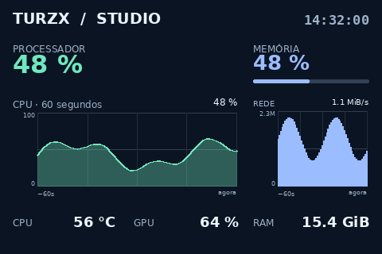

# Turzx Linux · Studio 1.2

**Sua telinha de 3,5″, do seu jeito, no Linux.**

Editor nativo em português para a **Turing/TURZX revisão A**. Monte um painel com
textos livres, gráficos e sensores de CPU, GPU, memória e rede. Arraste os elementos,
ajuste as propriedades e envie o tema pela conexão USB.



*Tema renderizado pelo aplicativo em 480×320, com dados fictícios de demonstração.
Textos e gráficos estão diretamente sobre o fundo, sem contêineres.*

## O que você pode criar

- **Textos e leituras livres:** posição, fonte, tamanho, cor e alinhamento próprios.
- **Contêineres opcionais:** agrupe CPU, GPU ou qualquer conjunto de informações.
- **Gráficos de linhas, área e colunas:** escolha sensor, escala e histórico
  de 10 a 300 segundos, usando leituras coletadas durante a execução.
- **Múltiplas GPUs:** selecione uma placa por contêiner ou por elemento.
- **Edição visual:** arrastar, redimensionar, camadas, duplicar e desfazer.
  Pontos de alinhamento sempre visíveis; encaixe de 8 px opcional.
- **Biblioteca acessível:** CPU, GPU, Memória, Rede e Sistema em categorias fixas,
  busca sem acentos e interface escura com textos de alto contraste.
- **Temas portáteis:** importar/exportar JSON, inclusive a imagem de fundo.
- **Controle USB:** brilho, rotação, teste de cores, reconexão e início no login.

## Instalar ou atualizar

No Ubuntu/Debian, abra um terminal na pasta do projeto:

```bash
./instalar.sh
```

O instalador constrói o pacote, solicita a senha pelo `sudo` e instala dependências
e a regra de acesso USB. Abra **Turzx Linux** no menu. Para atualizar, feche a janela
antiga e execute o mesmo comando. Preferências e temas são preservados.

O driver é o **cdc_acm, incluído no kernel Linux**. O aplicativo usa esse driver
e implementa a comunicação com a tela; não precisa de Wine ou driver Windows.

**Compatibilidade:** revisão A, USB `1a86:5722`, serial `USB35INCHIPSV2`,
320×480 em retrato ou 480×320 em paisagem. Outros modelos TURZX não são
automaticamente compatíveis. O dispositivo funciona como painel de informações;
o aplicativo não estende a área de trabalho. Veja
[instalação e atualização](docs/INSTALLATION.md) e [hardware](docs/HARDWARE.md).

## Seu primeiro tema

1. Abra **+ Novo → Tela vazia** ou importe [o exemplo](examples/free-telemetry.json).
2. Arraste **＋ Texto livre** para o fundo e altere o texto nas propriedades.
3. Escolha **Memória** na biblioteca e arraste **Uso da RAM** para a tela.
4. Arraste **＋ Gráfico**; nas propriedades, selecione a informação e a visualização.
5. Posicione os elementos pelos pontos de alinhamento. Desative **Encaixar em 8 px**
   quando quiser movimentação sem encaixe; os pontos continuam visíveis.
6. Clique em **Salvar** e depois em **Aplicar na tela**.

Salvar guarda o tema. Aplicar envia uma cópia do estado atual ao painel. Alterações
posteriores só aparecem na tela física quando você aplica novamente.
O [guia do editor](docs/EDITOR.md) explica gráficos, GPUs, contêineres e atalhos.

## Leituras disponíveis

| Categoria | Informações |
| --- | --- |
| CPU | Uso total e por thread, temperatura, frequência, modelo, núcleos e threads |
| GPU | Modelo, uso, temperatura, VRAM, potência, frequência e ventoinha |
| Memória | Percentual de uso, quantidade utilizada e total |
| Rede | Download e upload agregados das interfaces do sistema |
| Sistema | Uso do disco raiz, tempo ligado, relógio, data e texto livre |

Leituras indisponíveis aparecem como **N/D**. O suporte varia conforme hardware e
driver: AMD usa DRM/sysfs; NVIDIA usa `nvidia-smi` quando instalado; Intel tem
suporte parcial. Veja [detalhes dos sensores](docs/HARDWARE.md#sensores).

## Executar e desenvolver

Com as dependências instaladas, execute diretamente do código:

```bash
./abrir.sh
./abrir.sh --diagnose
python3 -m unittest discover -s tests -v
python3 scripts/build_deb.py
```

Python ≥3.10, GTK 4/PyGObject, Pillow, psutil e pyserial são instalados pelo gerenciador
da distribuição. O [guia de desenvolvimento](docs/DEVELOPMENT.md) descreve
arquitetura, testes, CI e empacotamento.

Os testes locais cobrem protocolo, serviço, sensores, temas, gráficos e operações
do editor. A validação da janela GTK requer sessão gráfica ou Xvfb; a transmissão
física requer o USB exposto ao processo. Testes sem hardware não substituem essa
conferência.

## Documentação

- [Instalação, atualização e remoção](docs/INSTALLATION.md)
- [Editor de temas e gráficos](docs/EDITOR.md)
- [Hardware e solução de problemas](docs/HARDWARE.md)
- [Desenvolvimento, testes e GitHub](docs/DEVELOPMENT.md)
- [Alterações](CHANGELOG.md) · [Como contribuir](CONTRIBUTING.md)

O aplicativo não envia telemetria. Preferências e temas ficam no seu computador.
GPL-3.0-or-later; veja [LICENSE](LICENSE) e [NOTICE](NOTICE). Projeto independente,
sem vínculo com a TURZX. O protocolo revisão A foi adaptado de
[turing-smart-screen-python](https://github.com/mathoudebine/turing-smart-screen-python).
