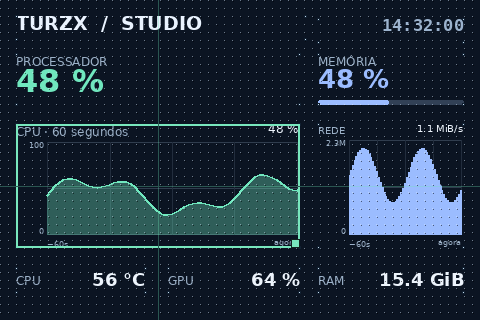

# Editor de temas

O Studio tem três áreas: **Biblioteca** à esquerda, tela de edição ao centro e
**Propriedades** à direita. A aba **Camadas** seleciona itens sobrepostos.

## Elementos livres

Arraste **＋ Texto livre** para a tela. Ele fica diretamente sobre o fundo, sem
borda, painel ou contêiner. Escolha texto, fonte, tamanho, cor e alinhamento nas
propriedades. Esse botão sempre cria um elemento livre, mesmo com um contêiner
selecionado.

Qualquer leitura também pode ficar sobre o fundo: arraste **Uso da CPU**, por
exemplo, para fora dos contêineres. Para inserir clicando na biblioteca, primeiro
clique no fundo ou selecione outro elemento livre. Se um contêiner ou seu filho
estiver selecionado, clicar numa leitura adiciona-a dentro desse contêiner.

O retângulo de seleção e seus pontos são ferramentas do editor; não aparecem
na tela física. **Mostrar rótulo** controla se o nome acompanha o valor.
**Destaque: valor grande** aumenta a leitura; **Linha: rótulo + valor** usa uma
composição compacta. **Valor com barra** representa métricas percentuais.

## Gráficos

Arraste **＋ Gráfico** para o fundo ou um contêiner. Nas propriedades:

| Opção | Uso |
| --- | --- |
| Informação | Sensor numérico que alimenta o gráfico |
| Visualização | Linhas, área ou colunas |
| Histórico | Janela de 10 a 300 segundos |
| Máximo da escala | `0` ajusta automaticamente; outro valor fixa o teto |
| Grade interna | Linhas dentro do gráfico |
| Espessura da linha | De 1 a 6 pixels |
| Cor do gráfico / barra | Cor do traçado, preenchimento ou colunas |
| Placa de vídeo | Seleciona a GPU para métricas de placa de vídeo |

O eixo horizontal termina em **agora**. Percentuais usam teto automático de 100;
outras informações usam o maior valor da janela com margem. As unidades são as
da leitura: °C, W, MHz, GiB, RPM ou percentual. Rede usa **bytes por segundo** na
escala manual; `1048576` equivale a 1 MiB/s. Tempo ligado usa segundos.

O histórico é real, mantido em memória por até cinco minutos. A prévia coleta
aproximadamente uma vez por segundo. O transmissor coleta no intervalo configurado
em **Configurar tela USB** e tem histórico próprio. Ao iniciar ou reiniciar o
processo, o gráfico preenche gradualmente. Aplicar um tema não transfere amostras
da prévia ao transmissor. Temas exportados não contêm dados coletados.

Uma amostra ausente produz uma lacuna, sem inventar zero ou ligar pontos através
da ausência. Sem histórico aparece **Coletando…** ou **Sem leituras**. Textos,
nomes de hardware, hora e data não são fontes de gráficos.

## Contêineres e GPUs

Escolha uma categoria e arraste **＋ Contêiner**. Insira leituras dentro dele;
seus filhos se movem junto com o grupo. Arraste pelo título ou selecione o grupo
em Camadas. Ajuste fundo, opacidade, borda, cantos e título.

Um contêiner GPU permite escolher a placa. Cada leitura ou gráfico GPU pode
herdar essa escolha ou apontar para outra placa. Elementos livres têm seleção
própria. Você pode exibir várias GPUs simultaneamente. A identidade é preservada
mesmo se a ordem de detecção mudar. Uma placa indisponível aparece como **N/D**.

**Memória** e **Rede** ficam sempre acessíveis sem depender da busca. Memória
lista uso percentual, quantidade utilizada e total; Rede lista download e upload.
A busca pesquisa todas as categorias e aceita termos sem acentos. Leituras por
thread ficam em uma seção própria dentro de CPU.

## Alinhar, dimensionar e organizar

*Canvas do tema de demonstração, com guias de edição. Não é uma captura da janela
completa do GTK.*

A grade de 8 px e os cantos dos elementos ficam sempre visíveis. **Encaixar em
8 px** controla somente o encaixe ao arrastar. A seleção também mostra linhas
centrais e um quadrado inferior direito para redimensionar.

Digite posições e dimensões nas propriedades. Itens livres usam coordenadas da
tela; filhos usam coordenadas relativas ao contêiner. Os limites mantêm elementos
na área disponível. Gráficos têm mínimo de 80×60 px.

Em **Camadas**, selecione elementos sobrepostos. Nas propriedades, traga para
frente, envie para trás, duplique ou exclua. Elementos livres e contêineres
compartilham a ordem de camadas; filhos permanecem dentro do grupo. Ao mudar
entre retrato e paisagem, a composição é ajustada ao novo tamanho.

| Atalho com a tela focada | Ação |
| --- | --- |
| `Ctrl+S` | Salvar |
| `Ctrl+Z` | Desfazer |
| `Ctrl+Shift+Z` | Refazer |
| `Ctrl+D` | Duplicar |
| `Delete` | Excluir |
| Setas | Mover 1 px |
| `Shift` + setas | Mover 8 px |

## Salvar, compartilhar e aplicar

**Salvar** atualiza o tema na biblioteca. **Salvar cópia** cria outro tema.
**Exportar** grava um JSON incluindo a imagem de fundo. **Importar** cria outra
entrada, sem sobrescrever o original.

**Aplicar na tela** guarda uma cópia do tema na configuração do transmissor.
Editar ou salvar depois disso não altera a tela até a próxima aplicação.
A imagem enviada não contém grade, seleção ou alças.

Limites: 32 contêineres, 32 informações por contêiner e 128 elementos livres.
